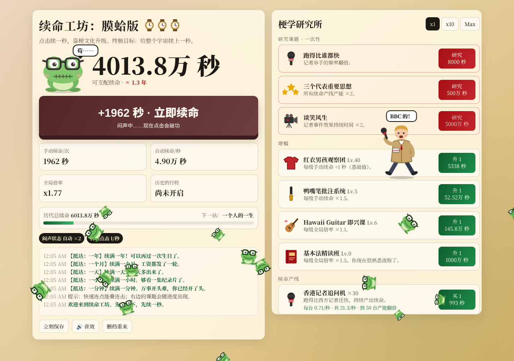

# 续命工坊 · 膜蛤版 (Xuming Studio)

一个受 Universal Paperclips 启发的网页放置/点击游戏。核心目标是 `续命`：

- 初始每次点击续命 `+1 秒`
- 花费已有秒数购买升级
- 利用手动增幅、自动产能、全局倍率不断滚雪球

## Preview



## Features

- 单文件前端实现（HTML + CSS + JS，无依赖）
- **原创美术与音效**：戴黑框眼镜的蛤吉祥物（会眨眼、说话，随状态变星星眼/生气/闷声拉链嘴）、三个会走的表、穿风衣挂 PRESS 牌横穿屏幕的西方记者、每个升级都有图标、里程碑下蛤雨；音效全部 WebAudio 合成（蛤叫、夏威夷滑棒吉他），可静音
- **手感**：点击飘字、连击条（最高 ×2）、产能翻倍提示、大事件弹字
- **记者举手**：随机出现的可点击事件 —— Excited!（自动 ×7）、I'm angry!（点击 ×15）、Too young too simple（一笔横财）、Sometimes naive（全场半价）、闷声发大财（自动 ×5，但一点按钮就破功）
- **研究课题**：Paperclips 式一次性研究，逐步解锁自动点击、闷声状态、三个代表、历史的行程等新机制
- **8 条续命产线**：从香港记者到宇宙续命引擎，下一条以「？？？」露出；10/25/50/100… 台时产能翻倍
- **人类尺度进度**：一分钟 → 一年 → 一个人的一生 → 中华五千年 → 地球年龄 → 宇宙年龄（结局）
- **历史的行程**（转生）：重开本轮换永久倍率
- 批量购买（x1 / x10 / Max）、中文大数单位（万/亿/兆/京/垓）
- 本地存档、离线收益（8h，研究「人生经验」后 24h），自动迁移 v1 存档

## Quick Start

1. 克隆仓库
2. 直接用浏览器打开 `index.html`

也可以用任意静态服务器启动（可选）：

```bash
python3 -m http.server 8080
```

然后访问 `http://localhost:8080`。

## Gameplay Loop

1. 连点主按钮续命，买第一批产线
2. 研究课题解锁新机制，抓住「记者举手」事件爆发增长
3. 在点击流和闷声流之间做取舍
4. 研究「一个人的命运」后推进历史的行程，带着永久倍率重开
5. 给宇宙续上一秒

## Save Data

游戏进度保存在浏览器 `localStorage`：

- key: `moha-clicker-save-v2`（首次打开会自动迁移 `v1` 存档）
- 支持手动保存、自动保存、删档重来

## Project Structure

- `index.html`: 游戏完整实现
- `gameplay.png`: README 预览图
- `README.md`: 项目说明

## Theme References

- https://en.wikipedia.org/wiki/Moha_(meme)
- https://en.wikipedia.org/wiki/Jiang_Zemin_Hong_Kong_journalist_incident
- https://en.wikipedia.org/wiki/Jiang_Zemin
- https://zh.wikipedia.org/wiki/%E9%B8%AD%E5%98%B4%E7%AC%94
- https://www.youtube.com/watch?v=MrUl7GMrKLM
